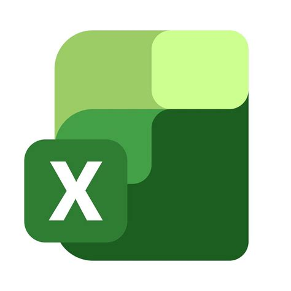
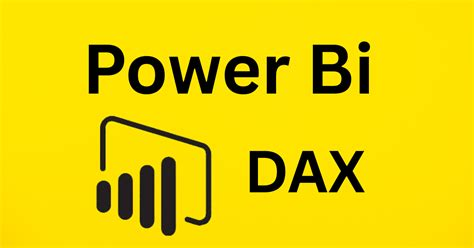
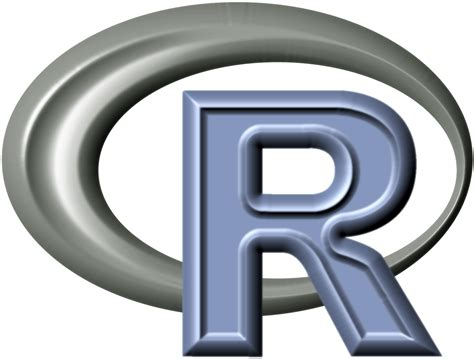
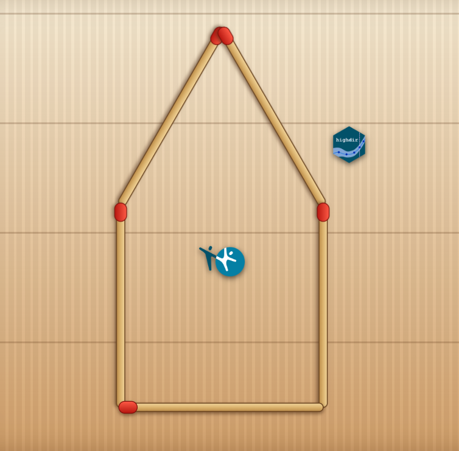

<h1> highdir <br>  </h1>

<h2> Datavisualisering etter Hdirs spesifikasjoner <h2>

<hr>

<h3> Demo, tips️ og triks</h3>
<h4> Muligheter og potensial <h4>

<br>
<br>
<br>

<h6>Yusman Kamaleri<h6>
<h6> Workshop<h6>
<h6> 20.10.2026<h6>

<br>

{.absolute top=780 left=1450 width="250"}
{.absolute top=630 left=1250 width="250"}
{.absolute top=600 left=990 width="250"}

{.absolute top=290 left=1100 width="350"}


## Hva er highdir?
- R-pakke for **visualisering** av statistikk og nøkkeltall
- Basert på Hdirs designprinsipper
- Kan produsere både statiske og dynamiske (interaktive) figurer
- Forenkler arbeider av standardiserte visualiseringer

## Hva highdir ikke er
- Ikke et analyseverktøy
- Ikke et ETL- eller datavarehusverktøy (DAP)
- Ikke en backend- eller serverløsning

## Forutsetninger for bruk
- Rensede og aggregerte data (ikke rådata)
- Data i tabellformat (CSV, Excel, JSON osv.)
- Minst én kategorivariabel og én tallvariabel

```{r}
#| echo: false 

library(gt)
library(data.table)
dt1 <- fread("c://Users//ykama//Git-hdir//dataset//survey-data.csv")

gt(dt1[1:5]) |>
  tab_options(
    table.font.size = px(30),
    data_row.padding = px(20),
    table.width = pct(50)
  ) |>
  # Left-align the first column
  cols_align(
    align = "left",
    columns = 1
  ) |>
  # Make column headers bold with gray background
  tab_style(
    style = list(
      cell_fill(color = "gray90"),
      cell_text(weight = "bold")
    ),
    locations = cells_column_labels()
  )
```

## Data behandling og format

{.absolute top=250 left=280 width="350"}
{.absolute top=650 left=300 width="350"}
{.absolute top=350 left=750 width="350"}
{.absolute top=550 left=750 width="350"}
{.absolute top=350 left=1150 width="350"}
{.absolute top=550 left=1150 width="350"}

## Fra data til figur

:::: {.columns}
::: {.column width="50%"}

- Definer spesifikasjon (nødvendig) 

```{r}
#| eval: false
hd_spec()
```

- Definer utvalg (valgfritt)

```{r}
#| eval: false
hd_opts()
```

:::

::: {.column width="50%"}
- Generer figur

```{r}
#| eval: false
hd_make()
```

- Eksporter resultat

```{r}
#| eval: false
hd_save()
```
:::
::::

::: {style="margin-top:100px;"}
### Figur typer    
column, ranked_bar, line, scatter, arearange, pie, stacked_column, venn, (map)
:::

## Installasjon

- [CRAN](https://cran.r-project.org/web/packages/highdir/index.html)
- [Github](https://github.com/folkehelsestats/highdir)

```{r}
#| eval: false

# CRAN
install.packages("highdir")

# Github (dev versjon)
if(!require(remotes)) install.packages("remotes")
remotes::install_github("folkehelsestats/highdir")
```

## Demo 1
```{r}
#| eval: false

# Demo 1 
# ------------------------------------------------------------------------------
library(data.table)
library(highdir)

survey <- fread("c://Users//ykama//Git-hdir//dataset//survey-data.csv")

spec_col <- hd_spec(survey, x = "alder", y = "pct", group = "kjonn", n = "n")

opts_col <- hd_opts(
  title    = "Alcohol use by age group and kjonn",
  subtitle = "Source: Norwegian Directorate of Health",
  ylim     = c(0, 100),
  yint     = 20,
  ylab     = "Percentage (%)"
)

# Dynamisk (default)
fig <- hd_make(spec_col, "column", opts_col)

```

::: {style="margin-top:80px;"}
#### Tips

```{r}
#| eval: false

help(hd_spec)
help(hd_opts)
```
:::

## Demo 2
```{r}
#| eval: false

# Demo 2
# ------------------------------------------------------------------------------
dt <- fread("c://Users//ykama//Git-hdir//dataset//region-data.csv")

spec <- hd_spec(dt, x = "fylke", y = "prosent", n = "n")
opts <- hd_opts(title = "Fylker i Norge",
                subtitle = "Demo dataset",
                flip = TRUE)

hd_make(spec, "ranked_bar", opts, vs = "Norge", aim = 50)
hd_make(spec, "ranked_bar", opts, vs = "Norge", aim = 50, mode = "static")
```

::: {style="margin-top:80px;"}
#### Tips

```{r}
#| eval: false
geom_args("ranked_bar")
```
:::

## Demo 3

Shiny app

```{r}
#| eval: false

hd_app()
```

::: {style="margin-top:80px;"}
{width=1500}
:::

## Eksempler

:::: {.columns}
::: {.column width="60%"}
#### Articles

:::

::: {.column width="40%"}
#### Reference - Layered API

:::
::::

## Hvorfor highdir?
- Dagens [utfordringer](https://ybkamaleri.github.io/slides/2026-09-10-highdir/#/title-slide)
- Mange ulike måter å lage figurer på
- Avhengighet av enkeltpersoners kompetanse
- Forenkle ved eksport til HTML og PDF

::: {style="margin-top:80px;"}
### Ja takk, begge deler
Kan få i pose og sekk ved å kjøre denne i en quarto fil

```{sh}
#| eval: false

quarto render rapport.qmd --to typst && open rapport.pdf
quarto render rapport.qmd --to html && open rapport.html

```
:::

## Hvordan highdir bidrar
- Standardisert utseende
- Gjenbrukbare løsninger, og noen ekstra f.eks [skjermlesing](https://folkehelsestats.github.io/highdir/articles/accessibility.html)
- Tettere integrasjon med eksisterende R-verktøy
- Åpne for muligheter at flere kan bidra og vedlikeholde

## Gevinster
- Økt produktivitet
- Bedre kvalitet og konsistens
- Lavere opplæringsterskel for nye brukere
- Større grad av gjenbruk
- Mulighet for bredere bruk i organisasjonen
- Bedre samspill med eksisterende Hdir-løsninger

## Veien videre
- Videreutvikling av pakken
- Standardisering av figurer og maler
- Bedre støtte for PDF-eksport
- Dokumentasjon og opplæringsmateriell
- Innspill fra brukermiljøet

## Quiz

Skanne QRcode og integrer highdir ☺️ 

:::: {.columns}
::: {.column width="50%"}
{width=650 fig-aligh="center"}
:::

::: {.column width="50%"}
{width=600}
:::
::::

